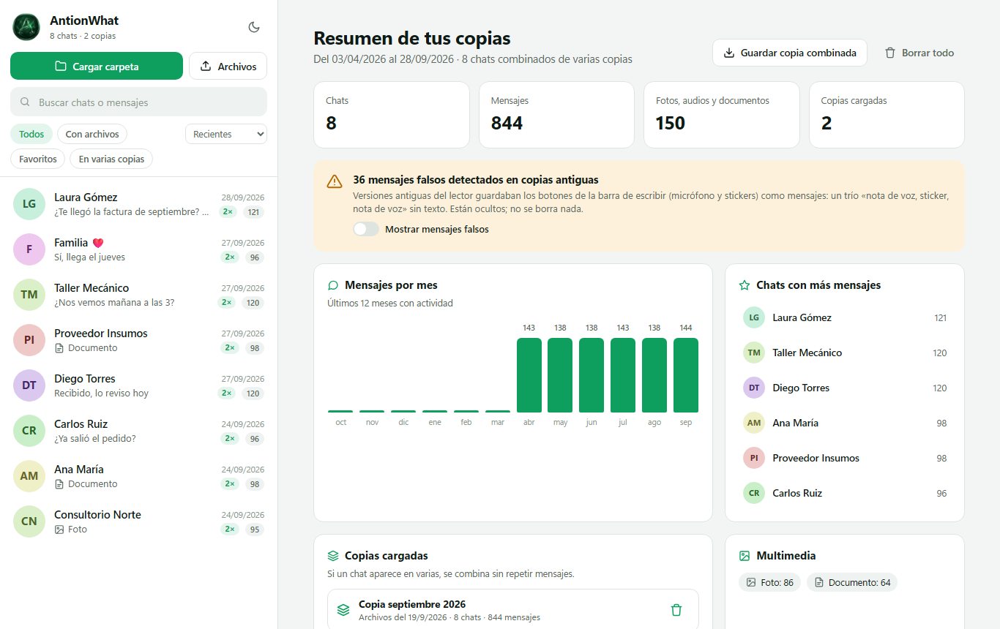
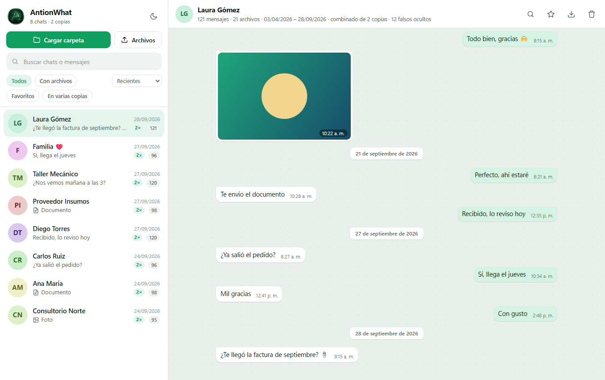
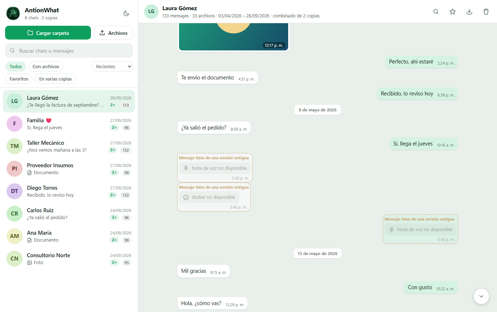
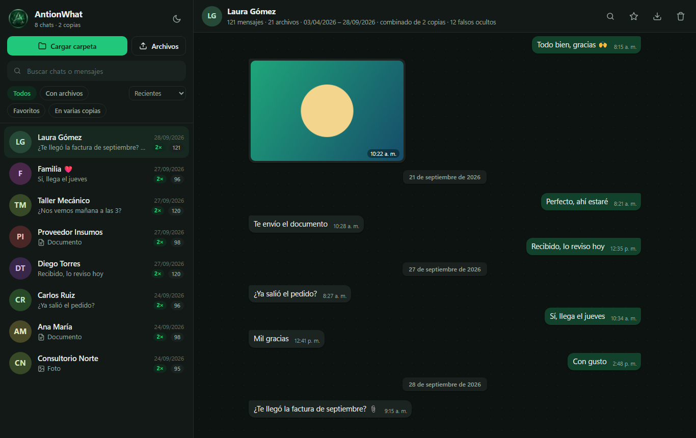
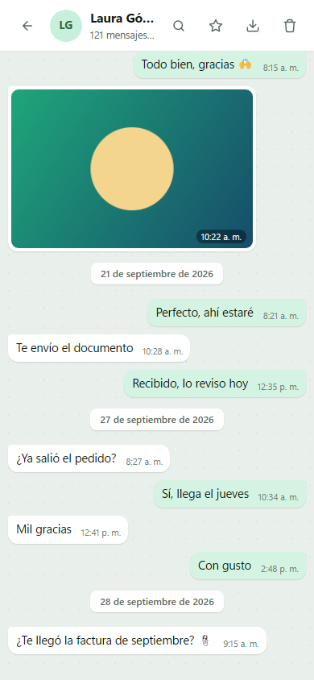

<div align="center">


# AntionWhat Web

**Visor de copias de WhatsApp: combina, limpia y busca en todas tus copias, sin subir nada a internet.**

[**Abrir el visor →**](https://antionart.github.io/AntionWhat/)


</div>

<p align="center"></p>

AntionWhat Web es el compañero de **AntionWhat**, la app de escritorio que exporta los chats de WhatsApp Business desde un teléfono Android.

Cada exportación es una *copia*: una carpeta con un `.json` y un `.html` por chat, más sus fotos, audios y documentos. Con el tiempo se acumulan varias copias, y cada una es una foto parcial del teléfono en un momento distinto. El visor las reúne en una sola vista.

## Qué hace

| | |
|---|---|
| **Combina copias** | Si un chat aparece en varias copias, se fusiona en orden cronológico y sin repetir mensajes. Lo que falta en una copia se recupera de otra. |
| **Limpia errores antiguos** | Las versiones anteriores del lector guardaban los botones de la barra de escribir (micrófono y stickers) como si fueran mensajes. El visor detecta ese patrón y lo oculta, sin borrar nada. Se puede volver a mostrar con un interruptor. |
| **Busca en todo** | La búsqueda ignora tildes y mayúsculas, recorre todos los mensajes de todas las copias y resalta las coincidencias. Dentro de un chat, `Ctrl+F` salta entre resultados. |
| **Muestra multimedia** | Fotos, videos, notas de voz y documentos se ven dentro del chat, con una galería a pantalla completa. |
| **Recuerda** | Los chats quedan guardados en el navegador (IndexedDB), así que no hay que volver a cargarlos cada vez. |
| **Exporta** | Descarga la copia combinada en un único `.json`, o un chat suelto en el mismo formato que usa AntionWhat. |

<p align="center">
  
  
</p>

## Formatos que entiende

- Carpetas de **AntionWhat 2.x**: un `.json` por chat, la carpeta `_media` y el `index.html`.
- Carpetas de **AntionWhat 1.x**: los `.html` por chat y el `index.html` con los datos incrustados.
- Exportaciones **`.txt` de WhatsApp** («Exportar chat»), con o sin archivos adjuntos.
- Copias guardadas desde este mismo visor (`antionwhat-copia-combinada-*.json`).

Se puede cargar una carpeta entera con el botón o arrastrarla a la ventana. Si la carpeta trae los `.json`, los `.html` repetidos se ignoran.

## Privacidad

El visor es una página estática. Toda la lectura, la combinación y la búsqueda ocurren dentro del navegador.

- **Nada sale del equipo.** La política de seguridad de contenido (CSP) bloquea cualquier conexión de red (`connect-src 'none'`), así que la página no puede enviar datos aunque quisiera.
- **Sin código de terceros.** No hay analítica, fuentes externas ni librerías: todo está en este repositorio.
- **El contenido de los chats se trata como no confiable.** Se escapa siempre antes de mostrarlo y nunca se ejecuta. No hay manejadores de eventos en línea, y la CSP prohíbe scripts en línea.
- **Los archivos multimedia no se copian.** Se ven mientras la carpeta está cargada, mediante enlaces `blob:` locales, y se olvidan al cerrar la pestaña.
- **Quitar datos.** «Quitar copia» o «Borrar todo» eliminan lo guardado en el navegador. Los archivos originales nunca se modifican.

## Cómo combina

Cada mensaje recibe una clave: dirección, día, minuto, tipo de archivo, los primeros 60 caracteres del texto normalizado y el nombre del documento. A esa clave se le suma un contador de repeticiones, para que dos «Ok» seguidos sigan siendo dos mensajes.

Cuando la misma clave aparece en varias copias, se queda la versión más completa: la que tiene texto más largo (por ejemplo, un «Leer más» ya expandido), la hora o el archivo adjunto.

Las fechas relativas («Hoy», «Ayer», «lunes») se resuelven según la fecha de los archivos de cada copia, así que dos copias hechas en meses distintos quedan alineadas.

Los mensajes falsos se reconocen por su firma: tres mensajes seguidos sin texto, con la misma hora, en el orden *nota de voz entrante → sticker entrante → nota de voz saliente*. Ese trío es el que dejaban los botones de la barra de escribir. Aparece miles de veces en copias anteriores a la versión 2.1 de la app de escritorio.

## Estructura

```
index.html          interfaz, íconos y CSP
assets/core.js      lectores de formatos, fechas, combinación y detección (sin DOM, probado con Node)
assets/store.js     persistencia en IndexedDB
assets/app.js       interfaz: importación, lista, resumen, conversación, búsqueda y galería
assets/app.css      estilos (tema claro y oscuro, móvil)
test/core.test.js   pruebas de core.js
```

## Desarrollo

No hay paso de compilación. Para probarlo en local:

```bash
python -m http.server 8000      # y abrir http://localhost:8000
npm test                        # pruebas de core.js (Node 18+)
```

GitHub Pages publica la rama `main` tal cual.

<p align="center">
  
  
</p>

<sub>Las capturas usan datos de demostración. Los nombres y mensajes son ficticios.</sub>
